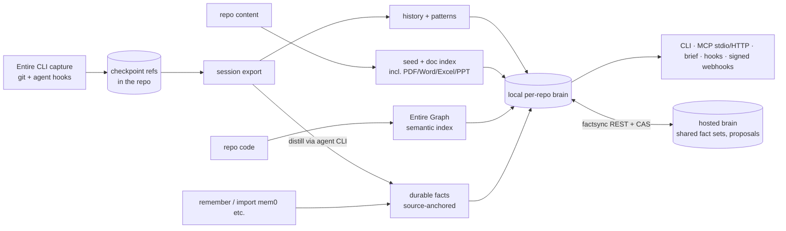

# Research: entireio/entire-brain

| | |
|---|---|
| **Date** | 2026-10-18 |
| **Subject** | `github.com/entireio/entire-brain` (and its sibling `entire-graph`) |
| **Confidence** | High on repo facts (GitHub API, the repo's own docs); Medium on positioning (no public launch coverage exists) |
| **Why it matters** | Entire is the main competitor in the Agent Forge research. Brain overlaps directly with spikes 010 and 014 (grounded knowledge and self-heal) |

## Executive summary
Entire Brain is Entire's **memory layer for a git repository**: a Go CLI/MCP plugin (MIT) that turns captured agent sessions and checkpoints, docs, git history and Entire Graph's code structure into queryable "durable facts", history, briefs and skills. It's **pre-GA but close**: nightly releases, an internal-only press release, and a GA checklist with all 11 gates ticked on a `v0.1.0` SHA.

It's a founder-driven flagship. About **2,050 commits since 2026-05-25, and 1,205 are by `ashtom` (Thomas Dohmke, Entire's CEO)**. Despite only 21 stars, it's a strategic product, not a side repo.

The important finding for us: Entire is extending *from git storage into governed knowledge*. It has a hosted brain with a cross-member **proposal queue** (apply/reject conflicting facts, compare-and-swap on the server). But its own docs admit shared facts have **no authenticated lifecycle or provenance**. That's precisely the trust gap Agent Forge and spikes 010/014 address.

## Timeline
| Date | Event | Source |
|---|---|---|
| 2025-08 | Dohmke announces he's leaving the GitHub CEO role | [Wikipedia](https://en.wikipedia.org/wiki/Thomas_Dohmke) |
| 2026-02-10 | Entire raises a $60M seed at $300M | TechCrunch (RESEARCH.md §4) |
| 2026-05-25 | `entire-brain` repo created | GitHub API |
| 2026-05-28 | `entire-graph` created (C/Go, MIT, 57★) | GitHub API |
| 2026-07-08 | Entire's distributed git network preview | entire.io news (RESEARCH.md §4) |
| 2026-10-16/17 | PR #392/#394: transcripts are read straight from git checkpoint **refs**, and the exported transcript files are dropped | commits |
| 2026-10-17 | Latest nightly `v0.1.0-nightly.202610170624` | releases |

## What it is (architecture)

- **Capture belongs to Entire, projection to Brain.** Brain never captures; it reads checkpoints. Without the CLI it falls back to code, docs and git history (`docs/concepts.md`).
- **Durable facts** have anchors back to source. Imported facts keep foreign anchors that "do not prove evidence in this repository".
- **Briefs** are bounded packets for a task (facts, code locations, likely tests). They're "a starting point for investigation, not proof".
- **Workspaces** span multiple repos, and `remember --global` stores facts that belong to no repo.
- **Local-first by default:** stdio MCP, with `ENTIRE_BRAIN_NO_EGRESS` and `LOCAL_ONLY`. Fact extraction uses whatever agent CLI is installed, at the user's token cost.
- **Hosted brain** (`internal/hostedbrain`, `internal/factsync`):
  - shared fact sets synced over REST;
  - cross-member **proposals** (`ListProposals`, `ApplyProposal`, `RejectProposal`) for conflicts that a sync kept both sides of;
  - the server only compare-and-swaps the heads; merging runs on the client (ADR-P1-E).

## Evidence culture (unusually rigorous)
- **GraphMark:** beats its baseline on 28/30 languages (exact McNemar p<0.05), 1,148 vs 802 correct. It's a CI gate whose report must regenerate byte-identically.
- **Agent lift:** only *one* narrow claim is proof-ready (history-channel correctness: no-brain 0/4 vs full-brain 4/4, `claude:sonnet:high`). The MCP, Radar, efficiency and codex-runner lifts are all still `no_release_claim`.
- **Facts:** "ship as a capability with no comparative-quality claim, because there are currently zero active durable facts".
- **Feature matrix:** 51 capabilities against Graphify, mem0, cognee, supermemory and codebase-memory-mcp, including 15 rows where Entire answers No.

## Self-admitted weaknesses
| Gap | Source |
|---|---|
| **Shared facts aren't authenticated.** A peer with write access can change status, provenance or superseded-by under a valid ID, "including retracting a statement or claiming a verified anchor". Hosted Search/Get responses are "untrusted historical evidence" | `docs/shared-fact-identity.md` |
| No proven agent lift beyond one narrow channel | press release / GA doc |
| Scale is "Unknown" at 100M lines (historical: 4.8M lines, 1.2 GB index, 12 s median code search) | feature-matrix |
| No OCR or image ingest; plain-file memory edits don't round-trip back into the store | feature-matrix |
| Operational rough edges: `status --json` takes about 1 min once facts exist (#325); brief locked the git index and broke other agents (#326); a facts-promote proposal flood (#324); Windows command-line length (#322) | open issues |
| Developer- and repo-centric: inputs are sessions, code, repo docs; no tickets, Slack, CRM or marketing sources | concepts.md |

## Overlap with our spikes
| Capability | Entire Brain | Automata spikes |
|---|---|---|
| Facts anchored to evidence, re-checked against the source | ✅ (repo anchors) | ✅ 010 (`repo://`, `ticket://`, `doc://`) |
| Non-code sources (tickets, docs, Slack) | Partial (office docs under `docs/`) | ✅ 010 (connectors are an open item) |
| Cross-department **conflict** detection ("code says 30, marketing says 14") | ❌ (conflicts are between *members*' facts) | ✅ 010, with no model call |
| Self-heal on merge, proportional model calls | Watcher plus refresh | ✅ 014 / 008 (coalesced, 1 model call for 300 merges) |
| Human approval queue outside GitHub, with provenance | Partial: hosted proposals, no authenticated lifecycle | ✅ 014 (provenance-gated) |
| Authenticated provenance and lifecycle | ❌ (stated gap) | ✅ forge ledger (003/005/006): runId-bound provenance |
| Agent execution, policy at push, server-side merge | ❌ | ✅ 003–006 |

## Strengths and weaknesses for Entire
**Strengths:**
- The founder is building it himself.
- It already integrates with Entire's capture (CLI) and storage (git network).
- It has a rigorous benchmark culture, local-first privacy, MCP, and multi-repo workspaces.
- Moving transcripts into git refs (#392/#394) unifies storage with the hosting product.

**Weaknesses:**
- Its trust model is client-side (capture hooks, client-side merge, unauthenticated shared heads).
- It doesn't prove agent value yet.
- It's engineering-only in scope.
- It's pre-GA, with early-adopter operational bugs.

## Implications for Agent Forge / Automata
1. **Entire's stack now spans storage (git network), capture (CLI checkpoints) and knowledge (Brain).** It is becoming a full "agent memory plus git" platform. Competing with it on memory or storage alone is a losing position.
2. **Our durable wedge is the one their docs explicitly leave open: an authenticated record and lifecycle protocol.**
   - **Server-side provenance:** gate-accepted ∪ forge-created ∪ imported (005).
   - **runId-bound separation of duties** (006).
   - **Human-approved knowledge changes** carrying provenance (014).
   - **Cross-department conflict detection** (010).
3. **Interop target.** Brain reads Entire checkpoint refs. If our forge enforces and preserves those refs (the entire-interop spike), Automata-run agents become first-class inputs to Entire Brain. Customers could then keep Brain for retrieval while governance runs through us.
4. **Watch:**
   - `factsync` and hosted proposals: if they add signed records, the gap closes.
   - Brain's GA announcement.
   - Whether hosted Brain gets an approval UI for non-engineers.

## Sources
- **Repo:** https://github.com/entireio/entire-brain, plus these files on its main branch:
  - `README.md`
  - `docs/concepts.md`
  - `docs/feature-matrix.md`
  - `docs/shared-fact-identity.md`
  - `docs/ga-readiness.md`
  - `docs/release_press_release.md`
  - `internal/hostedbrain/proposals.go`
  - open issues #322–#335
- **Sibling repo:** https://github.com/entireio/entire-graph
- **Package:** https://pkg.go.dev/github.com/entireio/entire-brain
- **Founder:** https://en.wikipedia.org/wiki/Thomas_Dohmke
- **Entire sessions and repositories docs:** https://docs.entire.io/guides/sessions/overview and https://docs.entire.io/guides/repositories/overview

## Confidence assessment
- **High:** commit and contributor counts, architecture, the self-admitted gaps and the hosted proposal API, all read from source.
- **Medium:** "pre-GA". GA gates are ticked on `v0.1.0`, but there's no public announcement, and releases are tagged nightly.
- **Low:** intent or roadmap. Nothing public beyond the repo.

## Methodology
- **Round 1, GitHub API:** summary, README, contributors, commits, tree.
- **Round 2, web discovery:** two searches. Nothing public turned up beyond pkg.go.dev.
- **Round 3:** read the repo's own docs and source (concepts, feature matrix, shared-fact identity, GA readiness, press release, hosted proposals) and the open issues.
- **Round 4:** compared against spikes 001–008 and 010/014 from this workspace.
