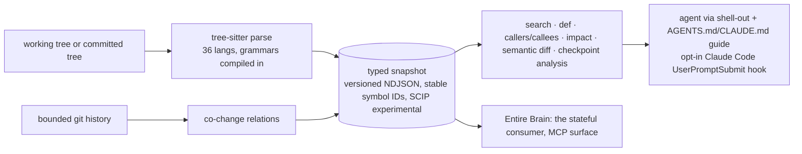

# Research: entireio/entire-graph

| | |
|---|---|
| **Date** | 2026-10-18 |
| **Subject** | `github.com/entireio/entire-graph`, Entire's semantic code graph (the provider behind Entire Brain) |
| **Confidence** | High on repo facts (GitHub API and repo docs); Medium on benchmark claims (attested, and the bundle isn't public) |
| **Companion report** | `research_entire-brain_20261018.md` |

## Executive summary
Entire Graph is an **MIT-licensed, local, no-egress code-intelligence plugin** for the Entire CLI. It gives agents a precomputed map of a repo:
- ranked code search;
- definitions, callers and callees, types, routes;
- change impact and semantic diffs, all with `file:line`.

It uses tree-sitter grammars compiled into the binary: semantic parsing for 36 languages and inventory for 149 more, with no model calls, API keys or telemetry.

It's the most mature part of Entire's open stack. There are about **2,450 commits since 2026-05-28**, and the two main authors are `ashtom` (Thomas Dohmke, 1,299 commits) and `suhaanthayyil` (1,027). The version is v0.4.1 (nightly), with 57★ and 68 forks.

Commercially it's a **wedge against agent token spend**. The README cites OpenRouter's head of insights: agentic token usage grew 14x from Feb to Aug 2026 (0.51T to 7.3T tokens). It also claims up to 71% token savings.

## Timeline
| Date | Event | Source |
|---|---|---|
| 2026-05-28 | Repo created | GitHub API |
| 2026-06-18 | v2 implementation plan (WP10 benchmark harness) archived | docs/benchmarks.md |
| 2026-09 | Search-ranking recall suite added (SWE-bench Multilingual gold-file recall@k); refuted two "plausible" ranking mechanisms (#247) | docs/benchmarks.md |
| 2026-09-06 | Burst of individual forks (4 on one day; probably a workshop or hackathon) | forks API |
| 2026-10-17 | v0.4.1 nightly; the GA gate (with Brain) is cut on `v0.1.0` of the provider schema contract | releases, Brain GA doc |

## Architecture and boundaries

`docs/brain-and-graph-boundaries.md` sets a clean rule:
- **Graph is a deterministic, stateless provider.** "Would this make two identical requests differ… If yes, it is Brain's."
- **Brain** owns MCP, multi-repo state, feedback loops and dashboards.
- **Declined:** a watch daemon and an HTML graph UI.
- **Not yet built:** per-file incremental invalidation (one-char commit = full rebuild).
- **Caching:** the cache is keyed by tree hash. A cold index on a new commit takes 10–30 s.

## Security posture (unusually careful)
`docs/trust-and-security.md`:
- No network during analysis.
- **Inherited global and system git config is disabled** before every git subprocess.
- `core.fsmonitor`, signatures, mailmap and submodule recursion are pinned off.
- Repo-local `include` / `includeIf` sections are refused.
- Promisor (partial-clone) config is refused.
- Mount points and off-volume redirects are rejected.
- `safe.directory` entries are scoped to the command.
- Recalled content is wrapped as untrusted data.

This **independently confirms spike 004's "hermetic git is mandatory" rule**, and goes further: refusing repo-local includes, fsmonitor and promisor settings is worth adopting for our forge and worker.

## Benchmarks and claims
| Claim | Evidence | Assessment |
|---|---|---|
| Semantic graph accuracy beats the baseline on 28/30 languages (1,148 vs 802) | GraphMark (in the `entirehq/graphmark` org), McNemar with Benjamini–Hochberg, a CI gate | Strong method; the suite lives in a separate, private-looking org |
| "Top score 94.74% on LoCoMo", "up to 71% token savings" | LoCoMo and LongMemEval are *conversational memory* benchmarks run on Graph's prose search, against Graphify: 0.914 vs 0.787 recall@10, 77.2% vs 59.3% QA. 35 of the 350 cases overlap tuning; the holdout is n=30 | **Attested, not reproducible.** The bundle "has no public download location". The headline number is off-domain for a code graph |
| Agent token savings | agentic-swebench "79 agent sessions" | The artifacts aren't in the repo; `stats` has a known ~30x exploration-call inflation bug (#274) |

## Open problems (41 open issues)
- **Search recall:**
  - intent-phrased queries miss the real answer (#319);
  - prose loses to code-spelled terms (#247).
- **Confidence:** preselection confidence is near zero and never surfaced (#273).
- **Caching:** the default query mode is the uncacheable worktree mode, and 95% of calls pay for it (#271).
- **VERIFY commands:** POSIX-only (#223), plus several test-task detection bugs (#205, #221–#225).
- **Language-specific bugs:** a stale Swift grammar (#345); C++ overload IDs (#214).
- **Launch-stack follow-ups:** route recall and false edges (#325).

## Strengths and weaknesses
**Strengths:**
- Deterministic and no-egress, with a stable NDJSON / SCIP contract.
- Strong security hygiene.
- Rigorous internal benchmarking with refutation logs.
- Founder-driven velocity.
- Wide language coverage.

**Weaknesses:**
- Headline marketing numbers rely on unpublished, off-domain evidence.
- Recall issues on natural-language queries.
- No incremental indexing (cold starts of 10–30 s per new commit).
- Single-repo by design.
- Requires the Entire CLI (distribution lock-in to Entire's plugin index).

## What this means for Agent Forge / Automata
1. **It's a building block, not a threat.** Graph is MIT, local and deterministic. It fits our sandbox and worker box as a harness battery (`entire plugin install graph` + `init-agents`), cutting agent exploration tokens. That directly lowers the cost per run, our biggest variable cost. **Candidate spike:** measure tokens and turns per Automata review run with Graph versus without it, on our own repos. This is the only way to validate the 71% claim for our workload.
2. **Its security rules should become forge and worker requirements:**
   - disable global and system git config;
   - refuse repo-local `include` / `includeIf`;
   - pin `core.fsmonitor=false`;
   - refuse promisor config on untrusted repos.

   Agent boxes clone customer repos, which is the same threat model.
3. **Strategic read.** Entire's open-source layer, Graph plus Brain, is the developer-adoption funnel. Hosting (the git network) and hosted Brain are the monetization path. Graph's "every request is deterministic" rule hands **all governance and state to Brain**, and Brain's own docs say its shared state is unauthenticated (see the companion report). Agent Forge's wedge stays the same: authenticated provenance, policy at push time, server-side merge and verify, and agent execution.
4. **Interop.** Graph analyzes Entire checkpoints (`commit` / checkpoint analysis). Our forge preserving checkpoint refs and `Entire-Checkpoint` trailers keeps Automata-run work visible to Graph and Brain, which supports the entire-interop spike.

## Sources
- **Repo:** https://github.com/entireio/entire-graph
  - `README.md`
  - `docs/benchmarks.md`
  - `docs/brain-and-graph-boundaries.md`
  - `docs/trust-and-security.md`
  - open issues #201–#345
- **GraphMark org:** referenced as `entirehq/graphmark`; not verified as public.
- **LoCoMo benchmark:** https://github.com/snap-research/locomo
- **OpenRouter stat (secondary):** quoted in the README from a LinkedIn post by OpenRouter's head of insights.
- **Companion report:** `research_entire-brain_20261018.md`

## Confidence assessment
- **High:**
  - repo metrics and authorship;
  - architecture and boundaries;
  - security behavior as documented;
  - open-issue themes.
- **Medium:** the GraphMark accuracy claims. The method is described, but the artifacts are in another org.
- **Low:** the LoCoMo 94.74% and 71% token-savings headlines. They're attested only, off-domain, and the bundle is unpublished.

## Methodology
- **Round 1, GitHub API:** summary, README, contributors, commit count, tree, forks, issues.
- **Round 3, repo documentation:** benchmarks, boundaries, trust and security.
- **Round 2 (web discovery)** was covered by the same-day Entire Brain research, which found no public launch coverage for Entire's open repos.
- **Round 4:** cross-referenced with spikes 001–008 and the Brain report.
